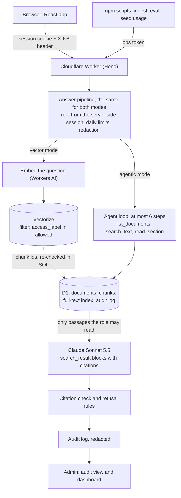

# Atlas Knowledge Assistant

A portfolio demo of an internal AI knowledge assistant for a **fictional** company, Atlas Logistics sp. z o.o. (120 people, Kraków). Employees ask questions in Polish or English and get answers grounded in company documents, with citations, role-based permissions, an audit log, an evaluation suite and an adoption dashboard.

**Live demo:** a `*.workers.dev` address (not indexed by search engines) that the author shares together with this repository; to run your own copy, see [Run it yourself](#run-it-yourself). Sign in with one click as Employee, IT Ops, HR, Finance or Admin; there are no passwords because the data is fictional. Each person can ask 25 questions a day. A two-minute walkthrough is in [DEMO_SCRIPT.md](DEMO_SCRIPT.md).

No real company or client data is used anywhere. Every person, number and document is invented, and the few fake personal data items (PESEL, IBAN, phone, e-mail) are marked FICTIONAL in the documents.

## What it is meant to show

| Claim | Where to look |
|---|---|
| **RAG** | Vector mode: embed the question, search with a role filter, answer with Claude from the retrieved passages, every answer cited. `src/worker/answer/vectorMode.ts`, `src/worker/retrieval/` |
| **Agents** | Agentic mode: Claude searches and reads documents itself through three tools in a loop of at most six steps. `src/worker/answer/agentic.ts`, `tools.ts` |
| **AI governance** | Permissions enforced before the model sees anything, redaction of personal data, prompt-injection handling, an audit log, spend limits, and an evaluation suite that checks all of it. See [Governance](#governance) |
| **Measured productivity** | An adoption dashboard (usage, refusals, thumbs, speed, cost) and a time-saved estimate that is labelled as an assumption, plus simulated history that is labelled as simulated. See [Measuring adoption](#measuring-adoption) |

The story of how it was built, with the numbers, is in [CASE_STUDY.md](CASE_STUDY.md) and the dated [BUILD_LOG.md](BUILD_LOG.md).

## Architecture



**The path of one question**

1. The browser sends the question with the session cookie. The Worker looks the session up in D1 and takes the **role from there**. Nothing in the request body can change it.
2. Daily limits are checked (per person, per network address, overall). The model is not called once a limit is reached.
3. Personal data in the question is redacted.
4. **Vector mode:** the question is embedded and Vectorize is queried with a filter on the access labels the role may read; the returned ids are checked again in SQL. **Agentic mode:** Claude calls `list_documents`, `search_text` (full-text search) and `read_section`; each tool runs a role-filtered SQL query and has no role parameter of its own.
5. Passages are redacted again and sent to Claude as native `search_result` blocks with citations switched on. Two versions of the same document are labelled CURRENT and OUTDATED.
6. The answer comes back with citations. Each one is **verified on the server** against the passages that were actually sent. An answer without a verified citation is withheld.
7. A row is written to the audit log (redacted) with the mode, sources, steps, tokens, cost and time.

## Roles and permissions

| Role | Reads documents labelled |
|---|---|
| Employee | general |
| IT Ops | general, IT, security |
| HR | general, HR |
| Finance | general, finance |
| Admin | general (like an employee), plus the audit log and the dashboard |

The policy is a single file, [`src/worker/access/policy.ts`](src/worker/access/policy.ts), and denies by default. The filter is applied in the SQL of every read, in the Vectorize query, and again on the ids Vectorize returns, so a faulty vector store still cannot leak a passage. **The prompt enforces nothing.** A document the role may not read looks exactly like a document that does not exist: the same refusal, the same "not found" on a source link.

## Governance

| Control | How it works |
|---|---|
| Permissions | Role-filtered SQL and vector queries; re-check after the vector search; tools without a role parameter. Tested for every role against every passage ([`tests/store.test.ts`](tests/store.test.ts), [`tests/tools.test.ts`](tests/tools.test.ts), [`tests/policy.test.ts`](tests/policy.test.ts)). |
| Answers only from sources | No verified citation means no answer. `[NO_ANSWER]` becomes a flagged refusal that names the document owner or the contacts directory. |
| Conflicting versions | Three planted pairs (remote work 2 vs 3 days, password 12 vs 14 characters, hotel limit 350 vs 450 PLN). The model sees both labelled CURRENT and OUTDATED, answers with the current one and mentions the older. |
| Personal data | PESEL (with checksum), phone, e-mail and IBAN (with mod-97) are redacted before the embedder, before the model, in tool results and before anything is logged. Names and street addresses are **not** detected. |
| Prompt injection | Document text reaches the model only as `search_result` data. A pattern detector flags suspicious passages, the UI shows a badge, and one planted document carries a canary string that the evaluation checks never appears in an answer. |
| Audit log | One redacted row per question, visible only to the Admin role, with filters and a detail view. |
| Spend and abuse | 25 questions per person, 20 per network address and 200 per day overall; at most 3,000 output tokens per answer and 6 agent steps; a monthly spend cap set in the Anthropic Console on a dedicated workspace. |
| Exposure | `*.workers.dev` only, `X-Robots-Tag: noindex` and a strict CSP on every response (static files included), `robots.txt` disallows everything. Secrets exist only as Worker secrets and the app fails closed without them. |

## Evaluation

A set of 40 questions in [`eval/cases.json`](eval/cases.json) (22 answerable, 2 with personal data, 3 with conflicting versions, 2 injection attempts, 6 that the asking role must be refused, 5 out of scope). Every expected fact carries the exact phrase from the document that proves it, and a test checks that each phrase is really there.

`npm run eval` runs every question in both modes as the asking role. Four checks need no model (right document retrieved, citations point to a document the role may read, refused exactly when it should be, no forbidden string in the answer). Four are judged by a different, stronger model (`claude-opus-5-5`) against a fixed rubric: faithfulness to the cited passages, key facts covered, the older version mentioned, injection followed. Results are stored in D1 and written to [`EVAL_REPORT.md`](EVAL_REPORT.md).

Second full run, 80 answers, cost $2.09:

| | Vector search | Agentic search |
|---|---|---|
| Right document retrieved | 29 / 29 | 29 / 29 |
| Blocked-for-role questions refused (must be 100%) | 6 / 6 | 6 / 6 |
| No forbidden string in any answer | 12 / 12 | 12 / 12 |
| Citations correct | 39 / 40 | 38 / 40 |
| Key facts conveyed (judge) | 30 / 30 | 29 / 30 |
| Answers that followed an injected instruction | 0 | 0 |
| Faithfulness, mean 1 to 5 (judge) | 4.9 | 4.8 |
| Average cost of an answer | $0.016 | $0.021 |

On this set the two modes are about equally good and agentic costs roughly a third more per answer. The set is small and was written by the author from the same documents the assistant reads, so it catches regressions and large differences; it is not a benchmark. The first run scored faithfulness 4.2 because my judge was given the cited passages in the wrong order and without the document-owner metadata the assistant had; that is fixed, both reports are kept (`eval/history/`), and the story is in the case study.

## Measuring adoption

The Admin role has a dashboard of aggregates from the audit log: questions per day, active users, answered with a source, refusal rate, thumbs-up rate (👍/👎 under every answer), average and 95th-percentile response time, cost per question, vector against agentic in use, and the latest evaluation. Definitions are in [`src/worker/admin/dashboard.ts`](src/worker/admin/dashboard.ts).

- **Estimated time saved** is answered questions times "minutes one manual search takes" (default 6, editable on the page, 1 to 60, attributed). It is an assumption and is labelled as one.
- **Two weeks of simulated usage** (`npm run seed:usage`) fill the dashboard before real visitors exist. Rows are marked `simulated` in the database, the users are `sim-NN`, the answer text starts with "[simulated]", and the dashboard shows a "Simulated data" badge with a switch to hide them. The questions, the cited sections and the prices are real; who asked when, how long it took and who pressed a thumb is invented.

## Stack

Cloudflare Workers (TypeScript, [Hono](https://hono.dev)), D1 (SQLite with FTS5), Vectorize, Workers AI (`@cf/qwen/qwen3-embedding-0.6b`, 1024 dimensions), Claude through the Anthropic API (`claude-sonnet-5-5` for answers, set in one constant in [`src/config.ts`](src/config.ts)), React 19 and Vite, Vitest. Tests run against the real migrations and real SQL (FTS5 included) through a `node:sqlite` stand-in for D1, with a scripted fake model that reads the real request and cites the way the API does.

## Repository layout

```
corpus/            36 fictional documents (Markdown with front matter), 5 access labels
eval/              cases.json (40 questions), probe.json (retrieval calibration), history/
migrations/        D1 schema: users, documents and FTS, audit log, eval, settings
scripts/           ingest, probe, try, eval, seed-usage, check-corpus
src/config.ts      model ids, prices, limits, thresholds: the one place for constants
src/worker/        access/ answer/ auth/ admin/ eval/ governance/ ingest/ ops/ retrieval/ simulate/
src/web/           React app: login, chat, source page, audit log, dashboard
tests/             423 tests
BUILD_LOG.md       dated entries with hours, usage and cost for every step
CASE_STUDY.md      what was built, what was measured, what went wrong
DEMO_SCRIPT.md     a two-minute walkthrough
```

## Run it yourself

You need Node 24, a Cloudflare account and an Anthropic API key.

```bash
npm install
cp .dev.vars.example .dev.vars   # then fill in ANTHROPIC_API_KEY and OPS_TOKEN
npx wrangler login               # the Workers AI binding needs a login, also in local development
npm run db:migrate:local
npm run dev                      # http://localhost:5173
npm run check                    # typecheck + 423 tests
```

To deploy: create a D1 database and a Vectorize index (1024 dimensions, cosine) and **create the metadata index on `access_label` before inserting any vector**, put the ids into `wrangler.jsonc`, then:

```bash
npm run db:migrate:remote
npx wrangler secret put ANTHROPIC_API_KEY     # never paste keys into chat or the repo
npx wrangler secret put OPS_TOKEN
npm run deploy
OPS_TOKEN=... npm run ingest -- --target https://<your-worker>.workers.dev
```

| Command | What it does |
|---|---|
| `npm run check` | Typecheck and all tests (must pass before every PR; CI runs it) |
| `npm run check:corpus` | Verifies the corpus: front matter, versions, personal data only where planned, the planted injection |
| `npm run ingest -- --target <url>` | Chunks, redacts, embeds and loads the documents, and waits until filtered vector queries work for every role |
| `npm run probe -- --target <url>` | Vector retrieval quality on 36 questions, no model call |
| `npm run try -- --target <url> --role hr --mode agentic --question "..."` | One question as a role, with answer, sources, steps and cost |
| `npm run eval -- --target <url> [--dry]` | The 40-question evaluation in both modes (about $2 per run; `--dry` only estimates) |
| `npm run seed:usage -- --apply local` | Loads the simulated usage into the local database |

## Known limits

- **Names and street addresses are not redacted**, and deliberately obfuscated personal data can slip through the pattern checks.
- The full-text index folds accents but not the letter ł, so a query typed without it will not match words containing it. Vector mode is not affected.
- The evaluation set is small, self-written and graded in part by a model that can be wrong. Two runs are two samples.
- When the assistant refuses a question it still often points to a named document owner or to the Helpdesk; this is noted in the build log as something to tune. (It used to say that personal data was "removed from the documents" when in fact the assistant masked it before reading; the prompt was the cause, is fixed and was spot-checked on four questions, but the evaluation reports were made before the fix.)
- The demo sign-in has no passwords on purpose. A real deployment would sit behind single sign-on and take permissions from the source systems; here the permission model is four roles and five labels.
- Cost figures are list-price estimates from token counts, not an invoice. The time saved is an assumption. The simulated history is simulated.

## License

MIT, see [LICENSE](LICENSE). All people, companies and documents in this repository are fictional.
